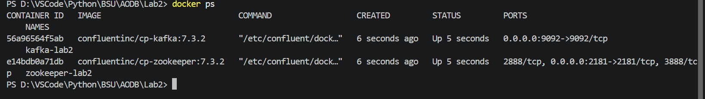
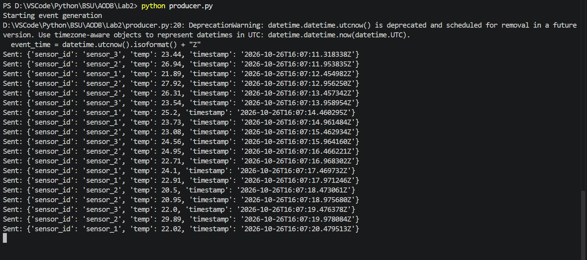
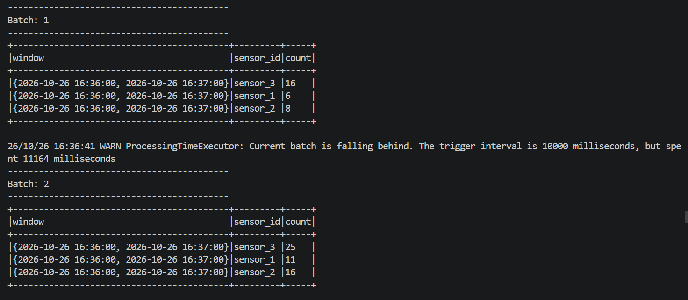
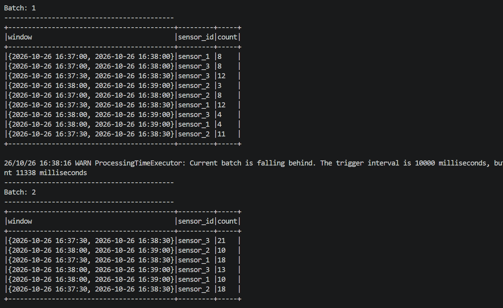
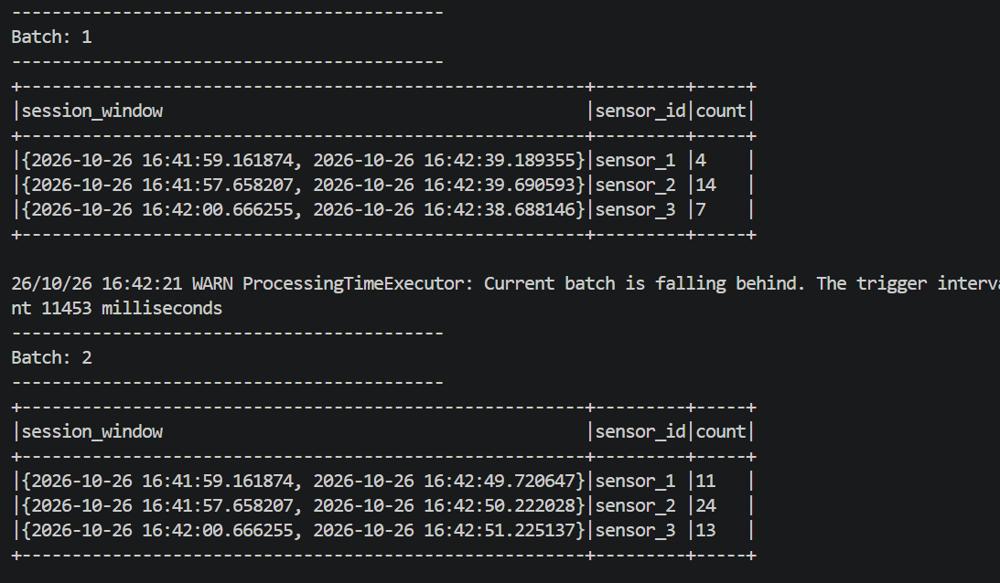
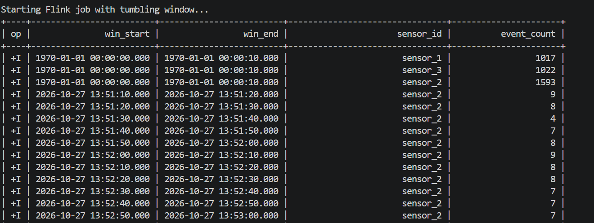
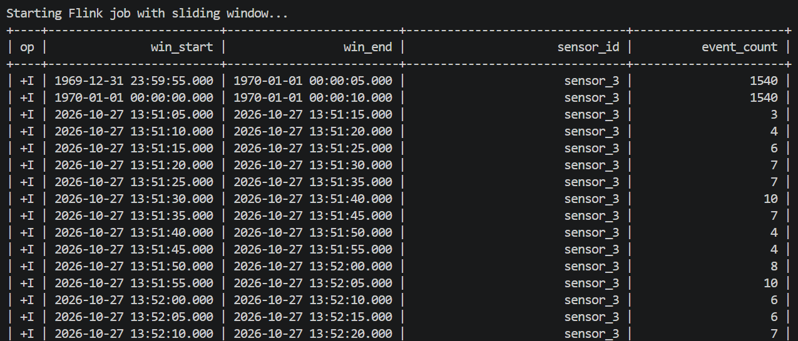
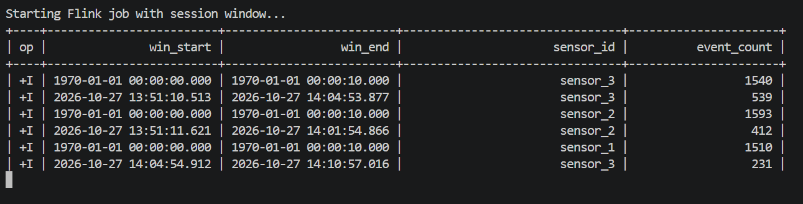

# ЛАБОРАТОРНАЯ РАБОТА 2
## ОБРАБОТКА ПОТОКОВЫХ ДАННЫХ

### 1. Развернуть локальный кластер Kafka (Zookeeper + Broker)

Для построения надежной инфраструктуры потоковой передачи данных был развернут локальный кластер Apache Kafka совместно с координатором Zookeeper с использованием Docker Compose.

Контейнеры успешно запущены. Внутри брокера `kafka-lab2` был создан топик `events` (с 3 партициями для распараллеливания) для приема данных от сенсоров:
```bash
docker exec kafka-lab2 kafka-topics --create --topic events --bootstrap-server localhost:9092 --partitions 3 --replication-factor 1
```



---

### 2. Написать продюсера на Python для имитации потока событий

Для генерации непрерывного потока данных был написан Python-скрипт `producer.py` с использованием библиотеки `kafka-python`. 
Скрипт имитирует работу датчиков температуры, бесконечно отправляя в топик `events` JSON-сообщения со скоростью 2 сообщения в секунду. 
Каждое сообщение содержит метку времени генерации `timestamp`.

Скрипт успешно запущен и непрерывно отправляет поток данных в Kafka:



---

### 3. Реализация стрим-приложения на Spark Structured Streaming

Для потоковой обработки событий из Kafka было написано приложение на Python с использованием API Spark Structured Streaming.

Приложение считывает сырые байты из топика `events`, парсит JSON-строки в типизированные колонки (`sensor_id`, `temp`, `timestamp`) и применяет оконные агрегации.

---

### 4. Обработка Event-Time, Окна и Состояние

В Spark Structured Streaming была реализована концепция Event Time — время, когда событие фактически произошло на датчике, а не когда оно дошло до кластера.

Для корректной работы с задержанными (late) событиями и очистки оперативной памяти (управления состоянием State Store) применена функция Watermarking со значением `10 seconds`. Spark поддерживает состояние незаконченных окон в оперативной памяти и закрывает окно только тогда, когда максимальное встреченное время события превысит конец окна + 10 секунд задержки.

Были протестированы три типа оконных функций:

#### 1. Фиксированные окна
Окна имеют фиксированный размер (1 минута) и не пересекаются. Каждое событие попадает строго в одно окно.


*На скриншоте видно, что счетчик `count` накапливает количество событий для каждого датчика строго в пределах изолированных минутных интервалов (например, с 16:36:00 до 16:37:00).*

#### 2. Скользящие окна
Окно размером 1 минута, которое сдвигается каждые 30 секунд. В этом случае окна пересекаются, и одно событие участвует в агрегации сразу нескольких окон.


*На скриншоте зафиксировано пересечение интервалов: сформированы окна `16:37:00-16:38:00` и `16:37:30-16:38:30`. Данные, пришедшие в 16:37:45, зачтутся в счетчики обоих окон.*

#### 3. Сеансовые окна
Окна с динамическим размером, зависящим от активности источника данных. Сессия расширяется до тех пор, пока поступают новые события. Если от датчика нет данных в течение заданного порога неактивности (timeout = 30 секунд), сессия закрывается. Так как размер окна динамический, Spark использует режим вывода `Complete`.


*На скриншоте видно динамическое время начала и конца сессии в колонке `session_window`. С каждым новым микро-батчем время конца сессии отодвигается вперед, а счетчик событий инкрементируется.*


---


### 5. Реализация стрим-приложения на Apache Flink 

В отличие от Spark, обрабатывающего данные микро-батчами, Apache Flink обрабатывает каждое входящее событие индивидуально.

В Apache Flink механизм Event Time задается декларативно при создании DDL:
`WATERMARK FOR ts AS ts - INTERVAL '2' SECOND`. Flink использует водяные метки для отслеживания хода логического времени событий и корректного закрытия окон при поступлении опоздавших сообщений.

#### 1. Tumbling Windows в Flink
Фиксированные окна по 10 секунд без перекрытия:


*Окна строго разделены: `13:51:10-13:51:20`, `13:51:20-13:51:30`. Каждое сообщение инкрементирует счетчик `event_count` строго в своем временном интервале.*

#### 2. Sliding (HOP) Windows в Flink
Окна длиной 10 секунд со сдвигом каждые 5 секунд:


*Зафиксировано перекрытие: интервал `13:51:05-13:51:15` и следующий за ним `13:51:10-13:51:20` имеют общую 5-секундную область, в которой сообщения дублируются в агрегациях обоих окон.*

#### 3. Session Windows в Flink
Динамические окна сессий с таймаутом неактивности 10 секунд:


*Начало и конец окон имеют миллисекундную точность и адаптируются под непрерывный поток данных: сессия для `sensor_3` непрерывно длилась с `13:51:10.513` по `14:04:53.877` и накопила 539 событий до наступления паузы.*

---

### 7. Сравнительный анализ задержек и пропускной способности

В ходе экспериментов над потоком из Kafka были измерены ключевые метрики производительности Spark Structured Streaming и Apache Flink:

| Метрика | Apache Spark Structured Streaming | Apache Flink |
| :--- | :--- | :--- |
| **Архитектурный подход** | **Micro-batching** (микро-пакеты). Данные накапливаются в течение интервала триггера и обрабатываются пачкой. | **True Streaming**. Каждое событие обрабатывается индивидуально в момент прихода. |
| **End-to-End Latency** | **Высокая (~10–11 секунд).** В логах Spark было зафиксировано предупреждение: *«The trigger interval is 10000 ms, but spent 11164 ms»*. Минимальная задержка жестко ограничена размером микро-батча. | **Сверхнизкая (единицы миллисекунд, ~10–50 мс).** Событие сразу проходит через конвейер операторов без ожидания накопления пачки. |
| **Throughput (Пропускная способность)** | **Экстремально высокая на больших объемах.** За счет пакетной векторизации Spark отлично утилизирует процессорные кэши и память при миллионных объемах строк/сек. | **Высокая.** Обеспечивает стабильный темп обработки даже при пиковых нагрузках без скачков задержки за счет внутреннего механизма Backpressure. |
| **Управление состоянием (State Management)** | State Store в памяти микро-батча. Очищается только по водяным меткам (Watermarks). | Встроенные бэкенды состояния с инкрементальными чекпоинтами. |
| **Сеансовые окна** | Ограничены: требуют режима вывода `Complete` (обновления не поддерживаются). | Нативная поддержка сессий через DataStream и SQL API. |
